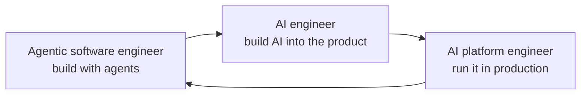

# The Roadmaps

Three careers, each one a road you can walk: the stages in order, what you can show at the end of each, a project that proves it, and the resources worth your time, ranked. Read this page to pick one. Then read that one.

**Contents:** The three · One loop · How to pick · How to read a road · Beyond the roads

---

## The three

| The road | You ship | The stages | The project |
|---|---|---|---|
| [AI engineer](ai-engineer.md) | features built on models: prompts and context, retrieval, tools and agents, evals | Foundations → Prompts and context → Evals → Retrieval → Tools and agents → Shipping → Production | one support desk, grown stage by stage |
| [Agentic software engineer](agentic-software-engineer.md) | whole products, front to back, with a coding agent as the daily tool | The ground → The web stack → Data and the backend → Tests and deploys → The agent as a daily tool → Review and scale → Ship a product | seven, from a repository map to a first customer |
| [AI platform engineer](ai-platform-engineer.md) | the platform the others build on: gateways, serving, eval gates, traces, cost | The ground → Serving and gateways → Infrastructure → Evals and CI for agents → Tracing, monitoring and cost → Security and access → The platform | seven that add up to one working platform |

Nothing here is research. No road needs heavy mathematics.

---

## One loop

Build with agents → build AI into the product → run it in production. Each road feeds the next, and many people walk two.

---

## How to pick

- **You like shipping whole things, and seeing users touch them** → agentic software engineer.
- **You like making a model do something it could not do yesterday, and proving it with an eval** → AI engineer.
- **You like systems that stay up, graphs that stay flat and a bill that makes sense** → AI platform engineer.

Not sure → walk the first two stages of the agentic road. Every road stands on it.

---

## How to read a road

- **A stage ends when its milestone is met.** There are no hours and no weeks. You are done when you can show the thing.
- **The steps are boxes.** Copy the page, and tick them.
- **Every project is built with a coding agent**, under the [light](../guide/light.md) or the [heavy](../guide/heavy.md) workflow, so you learn the craft and the agent together.
- **The stars are a judgment**, from 1 to 10, made on the date at the bottom of the page: clarity, depth, hands-on, current for a resource. Difficulty and what it teaches for a repository.
- **Free comes first.** A paid resource appears only when it is greatly better, with its price beside it.
- **Each road is grounded** in the job postings of the month it was written, and its last section shows the count.

---

## Beyond the roads

- [The topics](../topics/README.md) → five more, none of them a stage of a road.
- [The kit](../kit/README.md) → what to install for the work in front of you.
- [The communities](../community/README.md) → where the people of each road talk.
