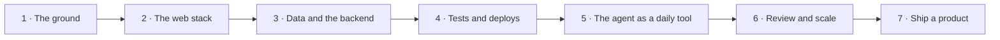

# Agentic Software Engineer

The road to shipping whole products, front to back, with a coding agent such as Claude Code or Codex as the daily tool. It teaches the fundamentals an agent cannot replace, then the craft of directing agents, then how to launch something real. Take it if you want to build software for a living, whether you start from zero or already write code by hand. There is no research on this road and no heavy mathematics.

**Contents:** The job · The road · Stage 1 · The ground · Stage 2 · The web stack · Stage 3 · Data and the backend · Stage 4 · Tests and deploys · Stage 5 · The agent as a daily tool · Stage 6 · Review and scale · Stage 7 · Ship a product · Project inspiration · The future · Where people talk · Grounded in

## The job

- What you ship → whole features and whole products: the screen, the API, the database, the tests and the deploy. The agent writes most of the code, and you answer for every line that ships.
- Who hires → startups first, for founding and product engineers, then established product companies, for full-stack and software engineers. The titles vary: software engineer, full-stack engineer, product engineer, founding engineer, AI-native engineer.
- What the work is, day to day → talk to the person who has the problem → write the brief → approve the plan → hand the build to one agent or to several → read the diff, run the tests, try it by hand → merge → deploy → watch production → fix what breaks.

## The road

The ground → the web stack → data and the backend → tests and deploys → the agent as a daily tool → review and scale → ship a product.

## Stage 1 · The ground

**You can now** → clone a repository you have never seen, explain how one feature works file by file, and land a change in it through a pull request.

**The steps**

- ⬜ Learn to program if you never have → variables, loops, functions, files → CS50x up to its Python lectures is enough to move on.
- ⬜ Work in the terminal → move, read, search, pipe one command into the next → until the mouse is the slower way.
- ⬜ Use git by hand → `add`, `commit`, `branch`, `merge`, `rebase`, `diff`, `log` → until you can undo each one without looking it up.
- ⬜ Open a pull request on GitHub → branch → commit → push → pull request → merge → the [Introduction to GitHub](https://github.com/skills/introduction-to-github) exercise walks you through it.
- ⬜ Read code you did not write → pick one feature of a real repository → follow it from the entry point to the last function → write the path down in ten lines.
- ⬜ Install one coding agent → [Claude Code](https://claude.com/pricing) comes with Claude Pro and [Codex](https://learn.chatgpt.com/docs/pricing) in the terminal comes with ChatGPT Plus, each `paid` at $20 a month → [opencode](https://github.com/anomalyco/opencode) is open source and free to install.
- ⬜ Let the agent read before it writes → ask it to explain a file → check the answer against the code → note where it was wrong.
- ⬜ Install the light workflow → three guards and one settings file → [light](../guide/light.md).

**The project** → Repo Map. A command-line tool that prints the map of any git repository: its folders, its largest files and the files that change most. Point it at a repository you did not write, and read the map before you read the code. **Proof** → it runs on three public repositories, and for one of them its change counts match what `git log` gives you by hand. **Workflow** → [light](../guide/light.md). **Kit** → [coding](../kit/coding.md).

**Resources**

| Resource | Free or paid | Clarity | Depth | Hands-on | Current | Excels at |
|---|---|---|---|---|---|---|
| [CS50x](https://cs50.harvard.edu/x/) | free | ★ 10 | ★ 8 | ★ 9 | ★ 9 | Programming from zero: C, Python, SQL and the web, with problem sets. Better than the rest here as a first step: the only one that assumes you have never written a program. |
| [The Missing Semester of Your CS Education](https://missing.csail.mit.edu/) | free | ★ 9 | ★ 8 | ★ 8 | ★ 10 | The shell, the editor, debugging and git in nine lectures, the 2026 edition with one on coding agents. Better at breadth: the whole toolbox in one place. |
| [Pro Git](https://git-scm.com/book/en/v2) | free | ★ 8 | ★ 10 | ★ 6 | ★ 7 | How git works underneath: branching, remotes, internals. Better at depth: the book to open when a merge or a rebase goes wrong. |
| [Learn Git Branching](https://learngitbranching.js.org/) | free | ★ 9 | ★ 6 | ★ 10 | ★ 8 | Branch, merge and rebase drawn as a live graph in the browser. Better at practice: you watch each command change the history. |
| [The Architecture of Open Source Applications](https://aosabook.org/en/) | free | ★ 8 | ★ 9 | ★ 6 | ★ 5 | Real systems explained by the people who built them. Better at reading code: start with 500 Lines or Less, 22 small programs read through by their authors. |

## Stage 2 · The web stack

**You can now** → send someone a link to a typed, accessible web app you built, and it works on their phone.

**The steps**

- ⬜ Build a page with HTML and CSS alone → semantic tags, flexbox, grid → one layout that holds on a phone and on a wide screen.
- ⬜ Learn JavaScript as a language → functions, closures, promises, `async` and `await`, modules → no framework yet.
- ⬜ Add TypeScript → strict mode on → type every function boundary → fix an error by reading it, never by reaching for `any`.
- ⬜ Learn React → components, props, state, effects → the quick start and the tutorial at [react.dev/learn](https://react.dev/learn).
- ⬜ Learn Next.js → routes, server and client components, data fetching, forms → build the dashboard of Next.js Learn from the first chapter to the last.
- ⬜ Make it usable by everyone → labels, focus order, contrast → run the whole app with the keyboard alone.
- ⬜ Put it online → push to GitHub → connect a host → every push gives you a URL to share.

**The project** → Deck. A flashcard app in the browser: decks, cards and a review screen driven by the keyboard. There is no server yet, so the cards live in the browser's own storage. **Proof** → a public URL that works on a phone, `tsc --noEmit` clean in strict mode, and a full review session done with the keyboard alone. **Workflow** → [light](../guide/light.md). **Kit** → [frontend](../kit/frontend.md).

**Resources**

| Resource | Free or paid | Clarity | Depth | Hands-on | Current | Excels at |
|---|---|---|---|---|---|---|
| [MDN: Learn web development](https://developer.mozilla.org/en-US/docs/Learn_web_development) | free | ★ 9 | ★ 8 | ★ 7 | ★ 9 | HTML, CSS, JavaScript and accessibility, from the people who document the web. Better at accuracy: what it says is what browsers do. |
| [The Odin Project: Full Stack JavaScript](https://www.theodinproject.com/paths/full-stack-javascript) | free | ★ 8 | ★ 8 | ★ 10 | ★ 8 | Seven courses with a project after every topic. Better at practice: the most projects on this list. |
| [The Modern JavaScript Tutorial](https://javascript.info/) | free | ★ 9 | ★ 9 | ★ 7 | ★ 8 | The language itself: closures, promises, modules, the browser. Better at depth on JavaScript. |
| [The TypeScript Handbook](https://www.typescriptlang.org/docs/handbook/intro.html) | free | ★ 8 | ★ 8 | ★ 5 | ★ 9 | Types from everyday use to narrowing and generics, by the team behind the language. Better at TypeScript: the only one here that teaches the type system. |
| [Next.js Learn](https://nextjs.org/learn) | free | ★ 9 | ★ 7 | ★ 10 | ★ 10 | One dashboard app built chapter by chapter: routing, data from a database, forms, login. Better at the framework: the only one that ends in a full Next.js app. |

## Stage 3 · Data and the backend

**You can now** → show an API with accounts on a Postgres database, where one user cannot read another user's data.

**The steps**

- ⬜ Learn HTTP → methods, status codes, headers, cookies, CORS → [MDN's HTTP guides](https://developer.mozilla.org/en-US/docs/Web/HTTP) → send your first requests by hand with `curl`.
- ⬜ Learn SQL → `SELECT`, `JOIN`, `GROUP BY`, `INSERT`, `UPDATE`, transactions → SQLBolt first, then CS50 SQL.
- ⬜ Run Postgres on your machine → create a database → design three tables with keys and constraints.
- ⬜ Change the schema only through migrations → every change is a file in git → a tool such as [Drizzle](https://orm.drizzle.team/docs/overview) writes and runs them.
- ⬜ Build the API → one route per action → validate every input → return one error shape.
- ⬜ Add accounts → hashed passwords, a session in a cookie, a logout that works → the [OWASP Authentication Cheat Sheet](https://cheatsheetseries.owasp.org/cheatsheets/Authentication_Cheat_Sheet.html) lists what to get right.
- ⬜ Check who may see what → every query filters by the signed-in user → try to read another account's data, and fail.
- ⬜ Make a slow query fast → read `EXPLAIN` → add the index → measure again.

**The project** → Shortlink. A link shortener with accounts: create a short link, count every click, show the count per day. Postgres holds the users, the links and the clicks, and every schema change is a migration. **Proof** → another account's link returns 404, the click count query uses an index in `EXPLAIN`, and an empty database builds from the migrations alone. **Workflow** → [light](../guide/light.md). **Kit** → [backend](../kit/backend.md).

**Resources**

| Resource | Free or paid | Clarity | Depth | Hands-on | Current | Excels at |
|---|---|---|---|---|---|---|
| [SQLBolt](https://sqlbolt.com/) | free | ★ 9 | ★ 5 | ★ 10 | ★ 7 | Eighteen short lessons with exercises in the browser. Better as a start: your first query runs before anything is installed. |
| [CS50's Introduction to Databases with SQL](https://cs50.harvard.edu/sql/) | free | ★ 10 | ★ 8 | ★ 9 | ★ 8 | Querying, relating, designing, optimizing and scaling, on SQLite, then Postgres and MySQL. Better as a full course: it teaches how to design a schema, not only how to query one. |
| [PostgreSQL: the official tutorial](https://www.postgresql.org/docs/current/tutorial.html) | free | ★ 7 | ★ 8 | ★ 7 | ★ 10 | Postgres itself: joins, views, foreign keys, transactions, window functions. Better on the database the postings name most, and current with each release. |
| [Use The Index, Luke](https://use-the-index-luke.com/) | free | ★ 8 | ★ 10 | ★ 6 | ★ 8 | How an index makes or breaks a query, written for developers. Better at performance: the deepest on why a query is slow. |
| [Full Stack Open](https://fullstackopen.com/en/) | free | ★ 8 | ★ 9 | ★ 10 | ★ 9 | A REST API in Node and Express, tested, with user accounts, then GraphQL and TypeScript. Better at the server: the only one that builds the code around the database. |

## Stage 4 · Tests and deploys

**You can now** → show a repository where a failing test blocks the merge and a green merge deploys itself.

**The steps**

- ⬜ Write unit tests → one behaviour per test → run them on every save.
- ⬜ Test the API against a real database → a test database, emptied between tests → no fake SQL.
- ⬜ Test the app as a user → a real browser signs up, creates a link, clicks it and reads the count.
- ⬜ Run everything on every push → one workflow → lint, types, tests → a red run blocks the merge.
- ⬜ Protect the main branch → no direct push → a pull request needs a green run.
- ⬜ Package the app → one container image → the same image runs on your machine and on the host.
- ⬜ Deploy from the main branch → a green merge ships itself → config comes from the environment, as [The Twelve-Factor App](https://12factor.net/) sets out.
- ⬜ See production → logs you can search, an error tracker, an uptime check → you learn about a failure before a user tells you.

**The project** → Green Main. Put Shortlink under test: unit tests, API tests on a real database and one browser test of the whole flow. Then wire the checks and the deploy so the main branch is always green and always live. **Proof** → a pull request with a broken test cannot merge, a merged fix reaches the live URL with no manual step, and an error thrown on purpose appears in the tracker. **Workflow** → [light](../guide/light.md). **Kit** → [testing](../kit/testing.md).

**Resources**

| Resource | Free or paid | Clarity | Depth | Hands-on | Current | Excels at |
|---|---|---|---|---|---|---|
| [Vitest: getting started](https://vitest.dev/guide/) | free | ★ 8 | ★ 7 | ★ 8 | ★ 10 | Unit tests for a TypeScript project, with a watch mode. Better at speed: the shortest path from no tests to a first green one. |
| [Playwright: getting started](https://playwright.dev/docs/intro) | free | ★ 9 | ★ 8 | ★ 9 | ★ 10 | Tests that drive a real browser, with a recorder, a trace viewer and a CI setup. Better at the user's view: the only one that tests what a person sees. |
| [GitHub Actions: quickstart](https://docs.github.com/en/actions/get-started/quickstart) | free | ★ 8 | ★ 5 | ★ 9 | ★ 9 | A first workflow that runs on every push. Better at the pipeline: the only one that makes the checks run without you. |
| [Docker: the Node.js guide](https://docs.docker.com/guides/nodejs/) | free | ★ 8 | ★ 7 | ★ 9 | ★ 9 | A TypeScript API in a container, developed against Postgres and tested there. Better at packaging: the only one that makes the app run the same everywhere. |
| [Software Engineering at Google](https://abseil.io/resources/swe-book/html/toc.html) | free | ★ 8 | ★ 10 | ★ 3 | ★ 7 | Why tests are shaped as they are: chapters 11 to 14 on testing, 23 and 24 on integration and delivery. Better at judgment: what to test, and at which size. |

## Stage 5 · The agent as a daily tool

**You can now** → hand an agent a one-page brief and show the merged pull request that came back, with the plan you approved and the guards that held.

**The steps**

- ⬜ Write the brief → the goal, what done looks like, what is out of scope, how it will be checked → one page → [plan](../guide/plan.md).
- ⬜ Read the plan before the first edit → plan mode → correct it → then let the agent build → [modes](../guide/modes.md).
- ⬜ Tell the agent what it cannot see → a short `CLAUDE.md` or `AGENTS.md` → the commands, the conventions, the traps → [context](../guide/context.md).
- ⬜ Give it a check to run → the test command → it runs before the agent says done → [checks](../guide/checks.md).
- ⬜ Turn the rules with no exceptions into guards → no secret written, the formatter, the tests → a hook enforces what a reminder cannot → [guards](../guide/guards.md).
- ⬜ Set what the agent may do alone → permissions and the sandbox → nothing bypassed on a machine that holds real secrets → [safety](../guide/safety.md).
- ⬜ Match the model to the job → the strongest for the plan and the hard bug, a faster one for routine edits → [models](../guide/models.md).
- ⬜ Keep sessions short → one task each → pass the state on in a file, not in a long chat → [handoff](../guide/handoff.md).

**The project** → One-Page Feature. Add expiring links and a QR code per link to Shortlink, from a brief you wrote. You approve the plan before the first edit, then the agent builds, tests and opens the pull request. **Proof** → the brief, the plan and the diff sit in one pull request, a planted fake key is stopped by the secrets guard, and the tests ran before the agent said done. **Workflow** → [light](../guide/light.md). **Kit** → [coding](../kit/coding.md).

**Resources**

| Resource | Free or paid | Clarity | Depth | Hands-on | Current | Excels at |
|---|---|---|---|---|---|---|
| [Claude Code: best practices](https://code.claude.com/docs/en/best-practices) | free | ★ 9 | ★ 9 | ★ 7 | ★ 10 | Tell the agent what it cannot see, give it a check to run, enforce the rules that have no exceptions. Better at completeness: one page that runs from the first prompt to sessions without you. |
| [Codex: working with agents](https://learn.chatgpt.com/docs/working-with-agents) | free | ★ 8 | ★ 6 | ★ 5 | ★ 10 | When to delegate, how to give a clear assignment, how to review and guide the work. Better on the handover itself, in OpenAI's own words. |
| [The Missing Semester: Agentic Coding](https://missing.csail.mit.edu/2026/agentic-coding/) | free | ★ 9 | ★ 7 | ★ 8 | ★ 9 | How agents work, context, `AGENTS.md`, skills, subagents, worktrees and what to watch for, with exercises. Better at neutrality: Claude Code, Codex and opencode in one lecture. |
| [Claude Academy: Claude Code 101](https://academy.claude.com/courses/claude-code-101) | free | ★ 9 | ★ 6 | ★ 7 | ★ 10 | Twelve lessons from the first prompt to explore → plan → code → commit. Better as a first course: the gentlest start on this list. |
| [AGENTS.md](https://agents.md/) | free | ★ 9 | ★ 4 | ★ 6 | ★ 9 | The open format for the instructions file, with sample files. Better at reach: one file read by Codex, Cursor, Copilot and many more. |

## Stage 6 · Review and scale

**You can now** → show three pull requests built at the same time by three agents, each reviewed by you and merged green, and one change made while nobody was watching.

**The steps**

- ⬜ Read every diff as if you wrote it → design first, then correctness, then tests, then names → nothing merges that you cannot explain.
- ⬜ Look for what agents get wrong → invented APIs, tests that prove nothing, a fix that hides the symptom → [checks](../guide/checks.md).
- ⬜ Add a second reader → a fresh agent reviews the diff with no memory of writing it → the decision stays yours.
- ⬜ Run agents side by side → one worktree and one branch each → one owner per file → [agents](../guide/agents.md).
- ⬜ Move every change through a pull request → the agent opens it, watches the checks and fixes what breaks → you merge → [pull requests](../guide/pull-requests.md).
- ⬜ Run an agent with nobody watching → headless, in CI or on a schedule → tight permissions and a log you read after → [unattended](../guide/unattended.md).
- ⬜ Keep the records → a tracker, a failure log, the decisions → each failure gets its cause and its guard → [heavy](../guide/heavy.md).
- ⬜ Count the cost → tokens per task and your attention per agent → stop adding agents when your review is the queue.

**The project** → Three Lanes. Three features for Shortlink built at once, one agent per worktree: team workspaces, API keys with rate limits, CSV import and export. Then one unattended run: an agent that reviews every new pull request in CI. **Proof** → three merged pull requests that carry your review comments, a main branch that stayed green throughout, and the log of the unattended run. **Workflow** → [heavy](../guide/heavy.md). **Kit** → [security](../kit/security.md).

**Resources**

| Resource | Free or paid | Clarity | Depth | Hands-on | Current | Excels at |
|---|---|---|---|---|---|---|
| [Google Engineering Practices: the reviewer's guide](https://google.github.io/eng-practices/review/reviewer/) | free | ★ 9 | ★ 8 | ★ 4 | ★ 7 | What to look for in a change, in what order, and how to write the comment. Better at judgment: the only one about review itself, and it holds for an agent's diff as for a person's. |
| [Claude Code: parallel sessions with worktrees](https://code.claude.com/docs/en/worktrees) | free | ★ 8 | ★ 9 | ★ 8 | ★ 10 | One agent per worktree, subagents in worktrees of their own, cleanup after. Better at isolation: the most exact on keeping parallel edits apart. |
| [Claude Code: run it programmatically](https://code.claude.com/docs/en/headless) | free | ★ 8 | ★ 9 | ★ 8 | ★ 10 | `claude -p` in scripts and CI: allowed tools, permission modes, structured output. Better on unattended runs with Claude Code. |
| [Codex: non-interactive mode](https://learn.chatgpt.com/docs/non-interactive-mode) | free | ★ 8 | ★ 8 | ★ 8 | ★ 10 | `codex exec` in scripts and CI: permissions, machine-readable output, resuming a run. Better on unattended runs with Codex. |
| [Claude Academy: Claude Code in action](https://academy.claude.com/courses/claude-code-in-action) | free | ★ 9 | ★ 7 | ★ 7 | ★ 10 | Nine lessons on longer sessions with less supervision: verification, hooks, scheduled and headless runs, review in GitHub Actions. Better as a course: the only one that walks this stage in order. |

## Stage 7 · Ship a product

**You can now** → give a stranger a link to a product you built and run, where they can sign up, do the one thing it promises and pay.

**The steps**

- ⬜ Find one person with one problem → write down what they do today → that is the first brief.
- ⬜ Cut the product to one flow → the shortest path that solves the problem end to end → everything else waits.
- ⬜ Build it under heavy → the tracker, both to-do lists, the failure log, the decisions → [heavy](../guide/heavy.md).
- ⬜ Add accounts and payments → a hosted checkout, webhooks, test mode first.
- ⬜ Review it for security before a stranger signs up → the OWASP Top 10 as the checklist → secrets, access control, input.
- ⬜ Make it fast on a slow phone → measure → fix the slowest page first.
- ⬜ Launch → your own domain, the error tracker on, a backup you have restored once.
- ⬜ Watch one person use it → fix the first thing that stops them → ship the fix.

**The project** → First Customer. A product of your own for a problem a real person told you about: accounts, one core flow, payments and monitoring. Agents build it under the heavy workflow, and the records stay in the repository. **Proof** → a live URL on your own domain, one signup from someone you have never met, one payment that completes end to end in test mode or live, and a tracker with no open box. **Workflow** → [heavy](../guide/heavy.md). **Kit** → [devops](../kit/devops.md).

**Resources**

| Resource | Free or paid | Clarity | Depth | Hands-on | Current | Excels at |
|---|---|---|---|---|---|---|
| [Stripe: a subscription page with Checkout](https://docs.stripe.com/billing/quickstart) | free | ★ 9 | ★ 7 | ★ 10 | ★ 10 | A subscription flow from a sample app: a hosted payment page, webhooks, a customer portal. Better at payments: the only one that takes money. |
| [OWASP Top 10](https://owasp.org/www-project-top-ten/) | free | ★ 8 | ★ 8 | ★ 4 | ★ 9 | The most common ways a web app is broken, in its 2025 edition. Better at safety: the checklist to hold an agent-built app against before strangers use it. |
| [Sentry docs](https://docs.sentry.io/) | free | ★ 8 | ★ 8 | ★ 8 | ★ 10 | Errors, traces and logs from the running product. Better after launch: the only one that tells you what broke. |
| [web.dev: Learn](https://web.dev/learn) | free | ★ 9 | ★ 8 | ★ 6 | ★ 8 | Courses on performance, accessibility and forms from the Chrome team. Better at feel: how fast and how usable the product is on a phone. |

## Project inspiration

Twelve public repositories to study or extend, easiest first. Difficulty is how hard the code is to read and to change. What it teaches is how much you take from the read. None is archived, and each had a commit on or after 2026-10-27.

| Repository | Difficulty | What it teaches | Why look |
|---|---|---|---|
| [realworld-apps/realworld](https://github.com/realworld-apps/realworld) | ★ 3 | ★ 7 | One app specified once and built in more than 100 stacks: an API spec, a shared theme and an end-to-end test suite. Build your own backend against the spec and let the suite judge it. |
| [SWE-agent/mini-swe-agent](https://github.com/SWE-agent/mini-swe-agent) | ★ 3 | ★ 8 | A coding agent whose core is about 100 lines of Python with one tool, bash. Read it once and you know the loop inside every agent you use. |
| [github/spec-kit](https://github.com/github/spec-kit) | ★ 4 | ★ 7 | Spec-driven development as commands: principles → spec → plan → tasks → build. See a brief and a plan become files an agent follows. |
| [anthropics/claude-code-action](https://github.com/anthropics/claude-code-action) | ★ 5 | ★ 7 | An agent inside GitHub Actions: it answers a mention, reviews a pull request, builds from an issue. A working example of an unattended run. |
| [documenso/documenso](https://github.com/documenso/documenso) | ★ 6 | ★ 8 | Document signing as a full product: React Router, Hono, Prisma, Postgres. One clear domain that you can read from the screen down to the table. |
| [dubinc/dub.link](https://github.com/dubinc/dub.link) | ★ 7 | ★ 9 | What Shortlink becomes at scale: Next.js, Prisma, Redis, a separate analytics store, Stripe. Compare its schema and its click pipeline with yours. |
| [excalidraw/excalidraw](https://github.com/excalidraw/excalidraw) | ★ 7 | ★ 8 | A whiteboard on an infinite canvas, shipped as an app and as an npm package. State, drawing and export with no backend to lean on. |
| [calcom/cal.diy](https://github.com/calcom/cal.diy) | ★ 8 | ★ 9 | Scheduling in a large monorepo: Next.js, tRPC, Prisma, Postgres. Practice for finding your way in a codebase too big to read whole. |
| [twentyhq/twenty](https://github.com/twentyhq/twenty) | ★ 8 | ★ 9 | A CRM in one Nx monorepo: NestJS, a job queue, Postgres, Redis and a React front. A typed backend and a typed frontend held together at this size. |
| [immich-app/immich](https://github.com/immich-app/immich) | ★ 9 | ★ 9 | Photo and video management: a NestJS server, a SvelteKit web app, a Flutter mobile app and a machine learning service in one repository. Four codebases that must agree on one API. |
| [openai/codex](https://github.com/openai/codex) | ★ 9 | ★ 9 | The Codex agent itself, open source, in Rust. Read how the tool you drive decides what it may run. |
| [supabase/supabase](https://github.com/supabase/supabase) | ★ 10 | ★ 9 | A backend platform assembled from open parts: Postgres, a REST layer, an auth server, a realtime server, storage. It shows how far Postgres can carry a product. |

Read the license before you reuse code → some are MIT or Apache-2.0, some are AGPL.

## The future

- The agent writes, you decide → some teams already say their engineers no longer type most of the code. What stays with you is the brief, the judgment on the plan and the proof that it works → learn to write the acceptance tests before the code exists.
- One agent becomes many → both agents ship worktrees, cloud sessions and scheduled runs. The limit moves from how fast you type to how much you can review → learn orchestration, isolation and what a task costs.
- Review becomes the queue → people who are not engineers build with the same agents, and an engineer answers for what they ship → learn to turn review into checks a machine runs: tests, guards, a second agent.
- The product has a model inside → product engineers are asked to build agent features, not only to use agents → learn tool calling, evals and MCP, the ground of the AI engineer road.
- The repository becomes the interface → instructions files, skills, hooks and MCP servers decide how well an agent works in a codebase → learn to build and share them, the ground of the AI platform engineer road.

## Where people talk

- `r/ClaudeCode` → Claude Code in real use: workflows, hooks, skills, limits.
- `r/codex` → Codex in the terminal and the cloud: releases, and how people work with it.
- `r/ChatGPTCoding` → the agents compared side by side by people who use several.
- `r/ExperiencedDevs` → working engineers on review, hiring and team practice now that agents write code.
- `r/webdev` → the web stack itself, and plain feedback on what you built.
- [Claude Discord](https://www.anthropic.com/discord) → Anthropic's official server, the place to ask in real time.
- [OpenAI Developer Community: Codex](https://community.openai.com/c/codex/37) → OpenAI's official forum: bugs, feature requests and the CLI.
- [Hacker News](https://news.ycombinator.com/) → launches, and the monthly "Who is hiring?" thread where many of these jobs are posted.

## Grounded in

- 31 postings from 31 companies, read in November 2026, each still listed as open on 2026-11-11 → 19 on career pages and job boards, 12 in the November 2026 "Who is hiring?" thread on Hacker News. Three more had closed and are left out.
- Titles → product engineer 9 · full-stack engineer 8 · founding engineer 5 · software engineer 4 · AI-native engineer 3 · other 2.
- Agents named → Claude Code 23 · Cursor 14 · Codex 13 · no agent by name 8.
- The stack → TypeScript or JavaScript 22 · React 18 · Postgres 12 · AWS 11 · Python 9 · Node.js 8 · Next.js 6.
- The duties → own the work end to end 19 · review or verify what the agent wrote 14 · work across the stack 14 · talk to users 11 · build an LLM feature into the product 10 · write tests 8 · run CI and deploys 8 · debug and watch production 8 · keep the agent's instructions, skills, hooks or MCP servers 8 · write the spec or the plan first 7 · run several agents at once 6 · guard secrets and private data 5 · teach the workflow to others 5.
- Experience asked → five years or more 6 · one year or less, new graduates included 6.
- No posting is linked → postings close.
- The stars are a judgment, made on 2026-11-11.
- Verified 2026-11-11: every link opened.
- The subreddits are named, not linked → Reddit turns automated readers away, so none could be opened. Each name was checked against a second source.
