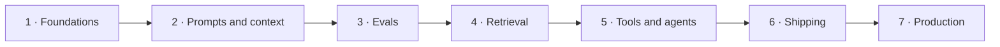

# AI Engineer

The road from a first program to a product feature built on a language model and kept working in production: prompts and context, evals, retrieval, tools and agents, shipping, running. Take it if you want to build with models and not train them: a developer moving into AI work, or a newcomer ready to learn to code on the way. It needs no heavy mathematics, every resource on it is free, and its seven projects add up to one product, Issue Desk, a help desk for an open-source project you choose, built stage by stage with a coding agent.

**Contents:** The job · The road · Stage 1: Foundations · Stage 2: Prompts and context · Stage 3: Evals · Stage 4: Retrieval · Stage 5: Tools and agents · Stage 6: Shipping · Stage 7: Production · Project inspiration · The future · Where people talk · Grounded in

## The job

- What you ship → features that call a model and can be trusted with real users: an assistant that answers from a company's own documents, a pipeline that turns messy text into clean records, an agent that acts with a person's approval, and the evals and traces that prove each one works.
- Who hires → product startups built on model APIs, software companies adding AI to a product they already sell, and consultancies and enterprises such as banks, insurers and airlines. The title varies: AI engineer, applied AI engineer, GenAI engineer, software engineer for AI.
- What the work is, day to day → read traces of what the feature did → find where it failed → change the prompt, the context, the search or a tool → run the evals → ship behind a flag → watch quality, cost and latency.

## The road

Foundations → Prompts and context → Evals → Retrieval → Tools and agents → Shipping → Production

## Stage 1: Foundations

**You can now** → hand someone a repository that starts with one command and passes its own tests: a small web API over a real database.

**The steps**

- ⬜ Write Python until you can read any file in a project → functions, classes, type hints, `async` and `await`, a virtual environment, a test in `pytest`.
- ⬜ Work in the shell → move around, pipe one command into another, set an environment variable, and keep every key in a `.env` file that Git ignores.
- ⬜ Use Git for every change → branch, commit, push, open a pull request, and undo each of them once on purpose.
- ⬜ Set up a coding agent under the [light workflow](../guide/light.md) → Claude Code or Codex with the three guards on, then one real change run as describe → plan → edit → test → commit.
- ⬜ Build an HTTP API → FastAPI: a route, a request model, a status code, an error, and a test that calls it.
- ⬜ Store data in Postgres → create a table, insert, join, add an index, and query it from Python.
- ⬜ Read TypeScript → types, `async` and `await`, `fetch` and modules, enough to follow the code of a web app.

**The project** → Issue Desk, the store. Pick an open-source project you use, pull a few hundred of its public issues through the GitHub API, and keep them in Postgres behind a small API that lists and searches them. It is the base every later stage builds on. **Proof** → a clean clone starts with one command, the tests pass, and a search for a word returns the issues that contain it. **Workflow** → [light](../guide/light.md): the agent writes the code, you read every diff and run every test yourself. **Kit** → [backend](../kit/backend.md).

**Resources**

| Resource | Free or paid | Clarity | Depth | Hands-on | Current | Excels at |
|---|---|---|---|---|---|---|
| [CS50's Introduction to Programming with Python](https://cs50.harvard.edu/python/) · Harvard | free | ★ 10 | ★ 6 | ★ 9 | ★ 7 | A first program, taught from zero with problem sets and a unit on tests. Clearer than any other row for someone who has never coded. |
| [The Missing Semester of Your CS Education](https://missing.csail.mit.edu/) · MIT | free | ★ 8 | ★ 7 | ★ 8 | ★ 10 | The shell, Git, debugging and packaging, with a lecture on agentic coding in the 2026 edition. The only row on the tools around the code. |
| [FastAPI Tutorial](https://fastapi.tiangolo.com/tutorial/) | free | ★ 9 | ★ 7 | ★ 10 | ★ 10 | An API built one step at a time, through to SQL databases, server-sent events and testing. The most hands-on row. |
| [PostgreSQL Tutorial](https://www.postgresql.org/docs/current/tutorial.html) | free | ★ 7 | ★ 6 | ★ 7 | ★ 10 | Tables, joins, transactions and window functions, from the database's own manual. The only row on SQL, and the link follows the current version. |
| [The TypeScript Handbook](https://www.typescriptlang.org/docs/handbook/intro.html) | free | ★ 8 | ★ 8 | ★ 5 | ★ 10 | The language from everyday types to generics, with a short path for people who know another language. The only row on TypeScript. |

## Stage 2: Prompts and context

**You can now** → run one command that reads a messy issue and prints valid JSON with its type, its area and a one-line summary, from two providers, with the tokens and the price of each call.

**The steps**

- ⬜ Make one call by hand → put the API key in the environment, send one request with `curl`, then with the official SDK, and read what comes back: the text, the stop reason, the token counts. The calls cost money, so start with a small prepaid balance and watch it.
- ⬜ Learn what the model sees → the system prompt, the messages and the tool results: the context window. What is not in the window does not exist for the model.
- ⬜ Write the prompt as a brief → say who the output is for and why, put the input inside tags, show three to five examples, state the format, and leave room to reason before the answer.
- ⬜ Fix the shape of the answer → define a schema, pass it through the provider's structured output feature, validate the result in code, and handle a refusal and a cut-off.
- ⬜ Count every call → log input tokens, output tokens, latency and price, then cache the part of the prompt that never changes and watch the price fall.
- ⬜ Run the same task on a second provider → keep the prompt, change the client, and write down what differed: the parameters, the format, the failures.
- ⬜ Treat the input as data → an issue can say "ignore your instructions". Keep it inside its tags, and never let it change the task.

**The project** → Issue Desk, triage. A command that reads one stored issue and returns its type, its area, its urgency and a one-line summary as JSON that passes a schema. One flag switches the provider, and every call prints its tokens and its price. **Proof** → 50 issues in a row parse without a schema error on both providers. **Workflow** → [light](../guide/light.md): the agent writes the client and the schema, you write the prompt and read the outputs. **Kit** → [coding](../kit/coding.md).

**Resources**

| Resource | Free or paid | Clarity | Depth | Hands-on | Current | Excels at |
|---|---|---|---|---|---|---|
| [Prompting best practices](https://platform.claude.com/docs/en/build-with-claude/prompt-engineering/claude-prompting-best-practices) · Anthropic docs | free | ★ 9 | ★ 9 | ★ 6 | ★ 10 | The living reference for current models: clarity, examples, tags, output format, thinking, prompts for agents. Deeper on technique than any other row. |
| [Prompt engineering](https://developers.openai.com/api/docs/guides/prompt-engineering) · OpenAI docs | free | ★ 8 | ★ 7 | ★ 7 | ★ 9 | Message roles, prompts versioned in code, few-shot examples, reasoning models. The row to read before the second provider. |
| [Structured model outputs](https://developers.openai.com/api/docs/guides/structured-outputs) · OpenAI docs | free | ★ 9 | ★ 7 | ★ 8 | ★ 9 | Output bound to a schema through Pydantic or Zod, and how a refusal shows up in code. The only row on the shape of the answer. |
| [Effective context engineering for AI agents](https://www.anthropic.com/research/effective-context-engineering-for-ai-agents) · Anthropic | free | ★ 9 | ★ 8 | ★ 3 | ★ 8 | Why context is a limited budget, and what to leave out of it. Better than the two guides on the window as a whole. |
| [Claude Cookbooks](https://github.com/anthropics/claude-cookbooks) · Anthropic | free | ★ 7 | ★ 7 | ★ 10 | ★ 9 | Notebooks to run and change: classification, summarization, caching, cost and latency. The most hands-on row. |

## Stage 3: Evals

**You can now** → show a table that scores two versions of your prompt on 60 issues you labeled by hand, and a pull request that turned red because the score fell.

**The steps**

- ⬜ Read the outputs before you measure anything → run 100 real issues, read every result, write one note per failure, and group the notes into failure types.
- ⬜ Build a golden set → 60 real inputs with the answer you expect, in a file in the repository, the hard and the hostile ones included.
- ⬜ Grade with code first → exact match on the type, a schema check, a length limit: whatever a machine can be sure of.
- ⬜ Add a model judge for the rest → one question per judge, pass or fail, the reasons before the verdict. Measure it against your own labels before you trust it.
- ⬜ Read a score with care → run each case more than once, report the pass rate with the number of cases, and treat a small change on a small set as noise.
- ⬜ Put it in CI → a fast subset on every pull request, the full set before a release, and a red build when the score falls under the line you set.
- ⬜ Turn every failure into a case → a bug found by hand goes into the golden set first and gets fixed second. From here on, no stage ships without a score.

**The project** → Issue Desk, the evals. Label 60 stored issues by hand, then score the triage command against them with code graders and one judge for the summary, checked against your labels. Compare two prompt versions and two models in one table of quality, price and latency. **Proof** → a pull request that carries a worse prompt fails in CI, and the table shows which version won and by how many cases. **Workflow** → [light](../guide/light.md): the agent may write the graders, the labels are yours alone. **Kit** → [testing](../kit/testing.md).

**Resources**

| Resource | Free or paid | Clarity | Depth | Hands-on | Current | Excels at |
|---|---|---|---|---|---|---|
| [Define success criteria and build evaluations](https://platform.claude.com/docs/en/test-and-evaluate/develop-tests) · Anthropic docs | free | ★ 9 | ★ 6 | ★ 9 | ★ 9 | First evals with code to copy: exact match, similarity, a judge with a rubric. The fastest start of the five. |
| [AI Evals: Everything You Need to Know](https://hamel.dev/blog/posts/evals-faq/) | free | ★ 9 | ★ 10 | ★ 6 | ★ 10 | About sixty questions answered from practice: error analysis, pass or fail judges, how many cases, retrieval and agents. The deepest row on method. |
| [Demystifying evals for AI agents](https://www.anthropic.com/research/demystifying-evals-for-ai-agents) · Anthropic | free | ★ 9 | ★ 8 | ★ 5 | ★ 9 | The vocabulary of task, trial, grader, transcript and outcome, and a roadmap from zero. The best row once the thing under test is an agent. |
| [Evaluation best practices](https://developers.openai.com/api/docs/guides/evaluation-best-practices) · OpenAI docs | free | ★ 8 | ★ 7 | ★ 5 | ★ 9 | What to evaluate in each design, from one call to many agents. The clearest map of where evals go. |
| [Promptfoo docs](https://www.promptfoo.dev/docs/intro/) | free | ★ 8 | ★ 7 | ★ 10 | ★ 10 | An open-source runner: declarative test cases, automatic scoring, a matrix view of the outputs, a place in CI. The most hands-on row, and it runs on your machine. |

## Stage 4: Retrieval

**You can now** → ask a question about the project's docs and get an answer that links to the passages it used, beside two numbers: how often the right passage is in the top five, and how often the answer is backed by what was found.

**The steps**

- ⬜ Ask whether you need retrieval at all → if the whole knowledge base fits in the context window, put it in the prompt and cache it. Retrieval starts where that stops.
- ⬜ Start with keyword search → Postgres full-text search over the docs. It is exact on names, error codes and flags, where vectors are weak.
- ⬜ Chunk the documents → split on headings, keep each chunk to a few hundred tokens, and store the page title and path with it.
- ⬜ Add vector search → embed each chunk, store the vectors in pgvector under an HNSW index, and query by cosine distance.
- ⬜ Combine and rerank → run both searches, merge them with reciprocal rank fusion, then let a reranker order the top results and keep five.
- ⬜ Answer with citations → give the model the passages with their ids, require an id for every claim, check in code that each cited id exists, and let it say that it does not know.
- ⬜ Measure retrieval apart from the answer → write 40 questions with the passage that answers each. Score recall at five for the search and grounding for the answer, and fix the search first.
- ⬜ Keep the index true → hash each file, embed again only what changed, and delete what is gone.

**The project** → Issue Desk, answers. Index the project's docs in Postgres with full-text and vector search, and answer the issues typed as questions with links to the passages used. When nothing relevant is found, it says so and asks for the missing detail. **Proof** → the right passage is in the top five for 34 of 40 test questions, and every citation points to a passage that exists. **Workflow** → [light](../guide/light.md): give the agent the recall number as its target, and let the eval decide what stays. **Kit** → [data-ml](../kit/data-ml.md).

**Resources**

| Resource | Free or paid | Clarity | Depth | Hands-on | Current | Excels at |
|---|---|---|---|---|---|---|
| [Introducing Contextual Retrieval](https://www.anthropic.com/research/contextual-retrieval) · Anthropic | free | ★ 9 | ★ 7 | ★ 5 | ★ 7 | Measured gains from stacking embeddings, keyword search, added context and reranking, and when to skip retrieval. The best row on why hybrid search wins. |
| [Retrieval Augmented Generation guide](https://github.com/anthropics/claude-cookbooks/blob/main/capabilities/retrieval_augmented_generation/guide.ipynb) · Claude Cookbooks | free | ★ 8 | ★ 8 | ★ 10 | ★ 8 | A notebook that builds three levels of retrieval and scores each with precision, recall, MRR and end-to-end accuracy. The only row that measures as it builds. |
| [pgvector](https://github.com/pgvector/pgvector) · README | free | ★ 8 | ★ 8 | ★ 9 | ★ 10 | Vectors in the database you already run: HNSW indexes, distance operators, hybrid search. The reference for the storage step. |
| [Hybrid search](https://supabase.com/docs/guides/ai/hybrid-search) · Supabase docs | free | ★ 9 | ★ 6 | ★ 9 | ★ 8 | Full-text and vector search merged by reciprocal rank fusion in one SQL function you can copy. Shorter and more direct than the other rows. |
| [Retrieve & Re-Rank](https://sbert.net/examples/sentence_transformer/applications/retrieve_rerank/README.html) · Sentence Transformers docs | free | ★ 8 | ★ 7 | ★ 8 | ★ 8 | Why a second, slower model reorders the first results, with open models you can run yourself. The only row on reranking itself. |

## Stage 5: Tools and agents

**You can now** → hand an open issue to an agent and watch it search the docs, find duplicates and draft a reply, then stop and ask before it changes anything, with every step in a trace.

**The steps**

- ⬜ Write the loop yourself → define one tool with a JSON schema, run the call the model asks for, send the result back, and repeat until it stops. No framework yet.
- ⬜ Choose a workflow or an agent → fixed steps in code when you know the path, an agent that picks its own steps only when you cannot. Start with the simpler one.
- ⬜ Design tools for a model → few tools, names that say what they do, descriptions that say when to use them, results short enough to fit, errors that say what to try next.
- ⬜ Put limits around actions → tools that read run freely, tools that write wait for a person, and the loop has a step cap and a budget.
- ⬜ Keep the context small → as steps pile up, drop old tool results, keep notes in a file, and load only what the next step needs.
- ⬜ Rebuild it on an agent SDK → the Claude Agent SDK, the OpenAI Agents SDK or LangGraph, and note what came with it: sessions, handoffs, guardrails, tracing.
- ⬜ Serve your tools over MCP → one server with the same tools, so Claude Code or Codex can use them too.
- ⬜ Evaluate the agent → 20 issues with the end state you expect, graded on the outcome and not on the path, with every failed run read step by step.

**The project** → Issue Desk, the agent. An agent that takes one open issue, searches the docs and the stored issues, and drafts a reply or marks a duplicate, through tools you wrote and also serve over MCP. It reads freely, and it writes only to a repository you own, after you approve. **Proof** → it reaches the expected end state on 16 of 20 test issues, and no run writes anything without an approval. **Workflow** → [light](../guide/light.md): connect your coding agent to the MCP server it helped you build, and use the tools from inside it. **Kit** → [agents](../kit/agents.md).

**Resources**

| Resource | Free or paid | Clarity | Depth | Hands-on | Current | Excels at |
|---|---|---|---|---|---|---|
| [Building effective agents](https://www.anthropic.com/research/building-effective-agents) · Anthropic | free | ★ 10 | ★ 7 | ★ 4 | ★ 7 | Workflows against agents, five patterns, and the case for plain API calls first. The clearest place to start. |
| [Tutorial: Build a tool-using agent](https://platform.claude.com/docs/en/agents-and-tools/tool-use/build-a-tool-using-agent) · Anthropic docs | free | ★ 9 | ★ 7 | ★ 10 | ★ 10 | One tool call grown into a full loop with parallel calls and error handling, in code. The row for writing the loop yourself. |
| [Writing effective tools for agents](https://www.anthropic.com/research/writing-tools-for-agents) · Anthropic | free | ★ 9 | ★ 9 | ★ 7 | ★ 9 | Which tools to build, what they should return, and how to test them with an eval. Deeper on tool design than any other row. |
| [AI Agents Course](https://huggingface.co/learn/agents-course/unit0/introduction) · Hugging Face | free | ★ 8 | ★ 8 | ★ 9 | ★ 8 | A full course with three frameworks, a final assignment and a free certificate. The widest row, with a bonus unit on observability and evaluation. |
| [Build an MCP server](https://modelcontextprotocol.io/docs/develop/build-server) · MCP docs | free | ★ 9 | ★ 6 | ★ 10 | ★ 10 | A working server with two tools, connected to a client. The only row on the MCP step. |

## Stage 6: Shipping

**You can now** → send someone a link where they sign in, watch a drafted reply stream in, and approve, edit or reject it, while tests and evals guard every deploy.

**The steps**

- ⬜ Build the interface → a Next.js app on the AI SDK: the reply streams in, and a review queue offers approve, edit and reject.
- ⬜ Keep the model behind your server → the key never reaches the browser, every route checks who is calling, and each user has a rate limit.
- ⬜ Plan for the model failing → a timeout, a retry with backoff, a second model to fall back on, and a plain message when both are down.
- ⬜ Defend against injected instructions → issues, web pages and documents are data. Test with hostile ones, keep every write behind an approval, and read the OWASP list for LLM applications.
- ⬜ Package and deploy → a Dockerfile, a managed Postgres, one cloud, and secrets in the platform's store, never in the image.
- ⬜ Gate every deploy → tests and evals run in CI on each pull request, and only a green main branch deploys.
- ⬜ Release in steps → behind a flag, to yourself first, then to a few people, with a rollback you have tried once.

**The project** → Issue Desk, the review queue. A web app where the agent's drafts wait for a person: each one streams in, shows its sources, and can be approved, edited or rejected. It runs at a public address, behind a sign-in, with the evals in CI. **Proof** → another person signs in and approves a draft, a hostile issue fails to trigger a write, and a pull request with a failing eval cannot deploy. **Workflow** → [heavy](../guide/heavy.md): the work no longer fits one sitting and going public is hard to undo, so it gets a tracker, a failure log and pull requests watched to green. **Kit** → [frontend](../kit/frontend.md) and [security](../kit/security.md).

**Resources**

| Resource | Free or paid | Clarity | Depth | Hands-on | Current | Excels at |
|---|---|---|---|---|---|---|
| [Learn Next.js](https://nextjs.org/learn) | free | ★ 10 | ★ 7 | ★ 10 | ★ 9 | A full-stack dashboard built chapter by chapter: data fetching, streaming, authentication. The best row for a first web app. |
| [AI SDK: Next.js App Router quickstart](https://ai-sdk.dev/docs/getting-started/nextjs-app-router) | free | ★ 9 | ★ 6 | ★ 10 | ★ 10 | A streaming chat with tool calls, from an empty folder. The only row on streaming a model into a page. |
| [OWASP Top 10 for LLM Applications 2025](https://github.com/OWASP/www-project-top-10-for-large-language-model-applications/tree/main/2_0_vulns) | free | ★ 8 | ★ 8 | ★ 3 | ★ 8 | The ten risks to check before going public, one page each, from prompt injection to unbounded consumption. The only row on security. |
| [Build and share a containerized application](https://docs.docker.com/get-started/tutorials/run-an-app/) · Docker docs | free | ★ 9 | ★ 5 | ★ 10 | ★ 9 | Run a container, start a stack with Compose, build an image and share it. The shortest path to something you can deploy. |
| [Quickstart for GitHub Actions](https://docs.github.com/en/actions/get-started/quickstart) | free | ★ 9 | ★ 4 | ★ 9 | ★ 9 | A first workflow file that runs on every push. The row for the deploy gate. |

## Stage 7: Production

**You can now** → open one dashboard that shows what each request costs, how long it takes and how often people accept the draft, and point to a failure from real use that is now a test.

**The steps**

- ⬜ Trace every request → one trace per request, one span per model call, tool call and search, each with its tokens, price and latency. Langfuse is open source and can run on your own machine.
- ⬜ Set budgets → a price per request and a 95th-percentile latency you will defend, with an alert when either is crossed.
- ⬜ Cut cost and latency → cache the stable prefix, send easy steps to a smaller model, batch what can wait, shorten the context, run tool calls in parallel.
- ⬜ Collect feedback where people already act → approve, edit and reject are the signal. Store each edit beside the draft it changed.
- ⬜ Score live traffic → sample real requests, run your judge on them, and chart the pass rate beside the offline score.
- ⬜ Close the loop → a failure seen in a trace becomes an eval case, then a fix, then a guard.
- ⬜ Change models on evidence → when a new model ships, run the suite, compare quality, price and latency, and switch behind a flag.
- ⬜ Write incidents down → what failed, why, the fix, and what now prevents it, with no blame.

**The project** → Issue Desk, on call. Run the product on a stream of real issues, your own repository's or a replay of the stored ones, with tracing, a dashboard for cost, latency and acceptance, an eval on sampled live traffic, a fallback model and a budget. Keep a failure log in which every entry ends in a new eval case or a guard. **Proof** → the dashboard shows live numbers, one logged failure links to the test that now catches it, and a model swap is decided from a table. **Workflow** → [heavy](../guide/heavy.md): the product's loop of failure → fix → guard is the loop the heavy workflow already runs on your own work. **Kit** → [devops](../kit/devops.md).

**Resources**

| Resource | Free or paid | Clarity | Depth | Hands-on | Current | Excels at |
|---|---|---|---|---|---|---|
| [Langfuse docs](https://langfuse.com/docs) | free | ★ 8 | ★ 8 | ★ 9 | ★ 10 | Open-source tracing, evals on live traffic and prompts linked to traces, built on OpenTelemetry. The most complete row, and you can host it yourself. |
| [What We've Learned From A Year of Building with LLMs](https://applied-llms.org/) · Applied LLMs | free | ★ 9 | ★ 10 | ★ 3 | ★ 6 | Six practitioners on what breaks in production: evals, pinned model versions, guardrails, logging, team habits. The deepest row on judgment. |
| [Latency optimization](https://developers.openai.com/api/docs/guides/latency-optimization) · OpenAI docs | free | ★ 9 | ★ 7 | ★ 6 | ★ 9 | Seven principles for a faster feature, ending with the advice to skip the model when code will do. The clearest row on speed. |
| [Prompt caching](https://platform.claude.com/docs/en/build-with-claude/prompt-caching) · Anthropic docs | free | ★ 8 | ★ 9 | ★ 8 | ★ 10 | How a cached prefix is priced and where the cache breakpoints go. The only row on the price of a repeated prefix. |
| [Postmortem Culture](https://sre.google/sre-book/postmortem-culture/) · Google SRE book | free | ★ 9 | ★ 7 | ★ 4 | ★ 6 | How to write an incident down without blame. The only row on learning from failure. |

## Project inspiration

Twelve public repositories to study or extend, easiest first. Difficulty is how hard the code is to change. What it teaches is how much of this road you learn by working in it. None is archived, and each was pushed to on or after 2026-11-03.

| Repository | Difficulty | What it teaches | Why look |
|---|---|---|---|
| [anthropics/claude-cookbooks](https://github.com/anthropics/claude-cookbooks) | ★ 2 | ★ 7 | One technique per notebook: classification, retrieval with its evals, tool use, caching. Run one, then port it to your second provider. |
| [SWE-agent/mini-swe-agent](https://github.com/SWE-agent/mini-swe-agent) | ★ 3 | ★ 8 | A whole agent in about 100 lines, fixing real GitHub issues with a shell as its only tool. Read all of it, then add an approval step. |
| [modelcontextprotocol/servers](https://github.com/modelcontextprotocol/servers) | ★ 4 | ★ 7 | The shape of a tool server, in seven reference servers kept by the protocol's own maintainers. Copy the structure for the Issue Desk server. |
| [vercel/chatbot](https://github.com/vercel/chatbot) | ★ 5 | ★ 7 | A streaming chat app end to end: Next.js, the AI SDK, sign-in and stored history in one template. Swap its chat route for your agent. |
| [anthropics/claude-quickstarts](https://github.com/anthropics/claude-quickstarts) | ★ 5 | ★ 7 | Starter apps you can deploy, among them a support agent over a knowledge base and an agent that builds an app across sessions. Take one as the base of your own. |
| [promptfoo/promptfoo](https://github.com/promptfoo/promptfoo) | ★ 6 | ★ 8 | How an eval runner is built: evals, red teaming and CI checks in one tool. Write a grader of your own for it. |
| [openai/openai-agents-python](https://github.com/openai/openai-agents-python) | ★ 6 | ★ 8 | Handoffs, guardrails, sessions and tracing in a lightweight SDK with few abstractions. Follow one run and see where a guardrail stops it. |
| [UKGovernmentBEIS/inspect_ai](https://github.com/UKGovernmentBEIS/inspect_ai) | ★ 7 | ★ 9 | Evals as tasks, solvers and scorers, from the UK AI Security Institute, with more than 200 ready evals. Write a task for your own agent. |
| [BerriAI/litellm](https://github.com/BerriAI/litellm) | ★ 8 | ★ 8 | A gateway over more than 100 providers: routing, fallbacks, spend tracking. Trace one request through the router and its fallback. |
| [onyx-dot-app/onyx](https://github.com/onyx-dot-app/onyx) | ★ 9 | ★ 9 | Retrieval as a product: more than 50 connectors, hybrid search, and permissions carried over from each source. Add a connector. |
| [langfuse/langfuse](https://github.com/langfuse/langfuse) | ★ 9 | ★ 9 | The platform from Stage 7 in the open, built on OpenTelemetry: tracing and evals at scale. Follow one trace from the SDK to the screen. |
| [openai/codex](https://github.com/openai/codex) | ★ 10 | ★ 10 | A production coding agent in Rust: the agent loop, the sandbox, the execution policy. Read how it decides what needs approval. |

Read the license before you reuse code → seven are MIT or Apache-2.0, and GitHub reports no single license for the MCP servers, the chatbot template, litellm, onyx and langfuse.

## The future

- Agents get more room → the work moves from one request to tasks that run across sessions, inside permissions, approval points and an audit trail → learn harness design and state that survives a restart, starting with [Effective harnesses for long-running agents](https://www.anthropic.com/research/effective-harnesses-for-long-running-agents).
- Evals become the spec → teams write the eval before the feature, and test agents against simulated users and data → learn to build a simulation and to check a judge against human labels.
- Protocols replace glue code → MCP connects an agent to tools, [A2A](https://a2a-protocol.org/latest/) connects it to other agents, and [Agent Skills](https://agentskills.io/) package a procedure once for many agents → learn to design what your product exposes to other people's agents.
- Smaller models take the easy steps → fine-tuning and model routing already show up in the postings as a plus → learn when a small or open model does a step for less, prove it with your evals, and start at [Local and Open Models](../topics/local-models.md).
- The neighbouring roads → [Agentic Software Engineer](agentic-software-engineer.md) goes deeper on shipping whole products with a coding agent, and [AI Platform Engineer](ai-platform-engineer.md) on running models and agents in production.

## Where people talk

- `r/LLMDevs` → application questions from people building on model APIs: which provider, fallbacks, structured output, cost. Showcases and self-promotion are frequent, so read the questions.
- `r/Rag` → retrieval only: chunking, hybrid search, checking an index against its sources, when to skip retrieval. The closest match to Stage 4.
- `r/AI_Agents` → agent builders on autonomy, approvals, cost and what broke. A busy feed, with tool showcases mixed in.
- `r/LocalLLaMA` → open models and the hardware to run them. New open models are tried here as they come out.
- [OpenAI Developer Community](https://community.openai.com/) → the official forum, with categories for the API, prompting, Codex and open models.
- [Claude Discord server](https://www.anthropic.com/discord) → the official server that Anthropic's own docs point to for community help.
- [Hugging Face Forums](https://discuss.huggingface.co/) → the forum of the open-model hub: datasets, Spaces and research, with a category for beginners.
- [Model Context Protocol discussions](https://github.com/modelcontextprotocol/modelcontextprotocol/discussions) → questions on building clients and servers, and where the protocol goes next.

## Grounded in

- 20 postings for AI engineer and its close titles, read in November 2026, each still listed as open on 2026-11-11 → 15 from named employers and 5 through recruiters for unnamed clients, from startups to a bank, an insurer and an airline. Sixteen more are left out: fourteen had closed, one was a copy with no source, and one was a platform role.
- What recurred → the number of the 20 that name each thing, as a requirement or as a plus, beside the stage that teaches it.

| What the postings name | Of 20 | Where the road teaches it |
|---|---|---|
| Evals | 20 | Stage 3, then every stage after it |
| Agents and tool calling | 20 | Stage 5 |
| A feature owned in production | 20 | Stages 6 and 7 |
| Tracing and observability | 16 | Stage 7 |
| Retrieval | 15 | Stage 4 |
| Python | 15 | Stage 1 |
| Prompt and context work | 14 | Stage 2 |
| Guardrails, permissions, human review | 13 | Stages 5 and 6 |
| Cost and latency | 13 | Stages 2 and 7 |
| TypeScript or JavaScript | 10 | Stages 1 and 6 |
| A cloud, most often AWS | 9 | Stage 6 |
| Work with customers or users | 9 | Stages 6 and 7 |
| Fine-tuning, mostly as a plus | 8 | The future |
| Full stack or frontend | 8 | Stage 6 |
| Two or more model providers | 7 | Stage 2 |
| LangChain, LangGraph or LlamaIndex | 6 | Stage 5 |
| SQL or Postgres | 6 | Stages 1 and 4 |
| CI, containers or tests | 6 | Stages 1, 3 and 6 |
| An eval or tracing tool by name | 6 | Stages 3 and 7 |
| A coding agent in the daily work | 6 | Every project |
| MCP | 5 | Stage 5 |

- Experience asked → five years or more 7 · one to three years 8 · no number 5.
- No posting is linked → postings close.
- Evidence → every resource is `read`, opened and read on the day. Every repository is `referenced`, checked through the GitHub API on the day and not run here.
- The subreddits are named, not linked → Reddit turns automated readers away, so none could be opened. Each was confirmed active on 2026-11-11 through a public archive of its posts.
- The stars are a judgment, made on 2026-11-11.
- Verified 2026-11-11: every external link opened.
