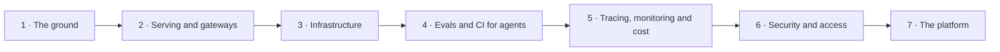

# AI Platform Engineer

The road to running models and agents in production: serving and gateways, evals as a pipeline, tracing and cost, CI for agents, security and access, and the infrastructure under all of it. It is what MLOps grew into. Seven projects, each built with a coding agent, add up to one working platform. Take it if you already write some code or run systems, and want to be the person who keeps AI up, fast and affordable. If you have never programmed, start with stage 1 of the [agentic software engineer](agentic-software-engineer.md) road. There is no research on this road and no heavy mathematics.

**Contents:** The job · The road · Stage 1: The ground · Stage 2: Serving and gateways · Stage 3: Infrastructure · Stage 4: Evals and CI for agents · Stage 5: Tracing, monitoring and cost · Stage 6: Security and access · Stage 7: The platform · Project inspiration · The future · Where people talk · Grounded in

## The job

- What you ship → the platform other engineers build on: one gateway to every model, serving that scales, eval gates in CI, traces and dashboards, a cost report per team, access rules that hold.
- Who hires → not only AI labs. In the 26 postings behind this page: finance, payments and insurance 6 · cloud, infrastructure and security vendors 5 · AI product companies and labs 5 · consultancies and staffing firms 4 · consumer, commerce and sports 3 · robotics and deep tech 3. The titles vary: AI platform engineer, ML platform engineer, MLOps engineer, AI infrastructure engineer.
- What the work is, day to day → roll out a model version → watch latency, errors and spend → answer the alert → find the cause in a trace → add the failure to the eval set → onboard the next team → write the runbook.

## The road

The ground → serving and gateways → infrastructure → evals and CI for agents → tracing, monitoring and cost → security and access → the platform.

## Stage 1: The ground

**You can now** → show a small API in a container that a CI run tests and builds on every push.

**The steps**

- ⬜ Work in the shell → files, pipes, processes, SSH, `curl` → the first three lectures of the Missing Semester.
- ⬜ Write Python with tests → a project made with `uv`, typed functions, `pytest` → 22 of the 26 postings name Python.
- ⬜ Use git with a team → branch → commit → pull request → revert → chapters 2 and 3 of Pro Git.
- ⬜ Build an HTTP API → FastAPI, a typed request and response, a `/health` route → `uv run fastapi dev` runs it.
- ⬜ Put it in a container → a Dockerfile → an image → a Compose file → one command starts it all.
- ⬜ Let CI prove it → a workflow file in `.github/workflows/` → the tests and an image build on every push → 22 of the 26 postings name CI/CD or GitOps.

**The project** → Relay. An API with one route that takes a prompt and returns the answer of a fake model, so no key is needed yet. It ships with tests, a Dockerfile and a CI workflow. **Proof** → a stranger clones it, runs one command and gets an answer, and the last run on the main branch is green. **Workflow** → [light](../guide/light.md). **Kit** → [coding](../kit/coding.md).

**Resources**

| Resource | Free or paid | Clarity | Depth | Hands-on | Current | Excels at |
|---|---|---|---|---|---|---|
| [The Missing Semester of Your CS Education](https://missing.csail.mit.edu/) | free | ★ 9 | ★ 8 | ★ 8 | ★ 10 | The shell, git, debugging and packaging in nine lectures, the 2026 edition. Better at breadth: the whole working environment in one place. |
| [Pro Git](https://git-scm.com/book/en/v2) | free | ★ 8 | ★ 10 | ★ 6 | ★ 7 | How git works underneath: branching, remotes, internals. Better at depth: the book to open when a merge goes wrong. |
| [FastAPI: tutorial](https://fastapi.tiangolo.com/tutorial/) | free | ★ 9 | ★ 7 | ★ 9 | ★ 9 | A typed API built step by step, every block runnable. Better at the service itself: the only one here that ends in an API. |
| [Docker: build and share a containerized application](https://docs.docker.com/get-started/tutorials/run-an-app/) | free | ★ 9 | ★ 4 | ★ 9 | ★ 9 | Run a container, start a Compose stack, build an image, push it. Better as a start: the shortest path to a first image. |
| [GitHub Actions: quickstart](https://docs.github.com/en/actions/get-started/quickstart) | free | ★ 8 | ★ 5 | ★ 9 | ★ 9 | A first workflow that runs on every push. Better at the pipeline: the only one here about CI. |

## Stage 2: Serving and gateways

**You can now** → show one OpenAI-compatible address that answers from a hosted model and from a model you serve yourself, with a key, a budget and a fallback per team.

**The steps**

- ⬜ Call a hosted model by hand → one `curl` to a chat endpoint → the same call streamed → read the token counts in the reply, because the provider bills by the token.
- ⬜ Serve an open model → `vllm serve <model>` → an OpenAI-compatible server on `localhost:8000` → vLLM runs on Linux, and 8 of the 26 postings name it.
- ⬜ Serve one with no GPU → `llama-server` from llama.cpp → the same OpenAI-style routes from a quantized model on a CPU.
- ⬜ Measure before you tune → time to first token, end-to-end latency, requests running → vLLM publishes them at [`/metrics`](https://docs.vllm.ai/en/stable/usage/metrics/) in Prometheus format.
- ⬜ Learn the levers → continuous batching, prefix caching, quantization, context length → change one, repeat the same load, write the number down.
- ⬜ Put a gateway in front → the LiteLLM proxy → one OpenAI-compatible endpoint for every provider and for your own server.
- ⬜ Give each team a key → a [virtual key](https://docs.litellm.ai/docs/proxy/virtual_keys) with its own models, budget and rate limit → it needs a Postgres database.
- ⬜ Make failure boring → two deployments behind one model name → retries, load balancing, a fallback when one is down.

**The project** → One Door. A Compose stack with a gateway in front of two backends: a hosted model and an open model you serve. Two teams, `goku` and `vegeta`, each get a key, a budget and a rate limit, and Relay now calls the gateway. **Proof** → stop one backend during a load test and every request still succeeds, then spend past `vegeta`'s budget and the gateway refuses the next call. **Workflow** → [light](../guide/light.md). **Kit** → [backend](../kit/backend.md).

**Resources**

| Resource | Free or paid | Clarity | Depth | Hands-on | Current | Excels at |
|---|---|---|---|---|---|---|
| [LiteLLM: AI Gateway](https://docs.litellm.ai/docs/simple_proxy) | free | ★ 7 | ★ 8 | ★ 9 | ★ 9 | Virtual keys, budgets, rate limits, fallbacks and cost per request in one self-hosted proxy. Better at the gateway: the only one here that covers the second half of the stage. |
| [vLLM: quickstart](https://docs.vllm.ai/en/stable/getting_started/quickstart/) | free | ★ 8 | ★ 6 | ★ 9 | ★ 9 | An OpenAI-compatible server from one command. Better at throughput: the server to learn when you have a GPU. |
| [llama.cpp: the server](https://github.com/ggml-org/llama.cpp/tree/master/tools/server) | free | ★ 6 | ★ 8 | ★ 8 | ★ 9 | OpenAI-style routes from quantized models, with parallel decoding, continuous batching and a metrics endpoint. Better at access: the only one here that runs on a CPU. |

## Stage 3: Infrastructure

**You can now** → delete your cluster, rebuild it from one repository, and roll out a new model version without a failed request.

**The steps**

- ⬜ Learn the objects → Pod, Deployment, Service, ConfigMap, Secret → Learn Kubernetes Basics walks create, deploy, explore, expose, scale and update on Minikube → 20 of the 26 postings name Kubernetes.
- ⬜ Package each service → one Helm chart → values per environment.
- ⬜ Declare what sits under the cluster → Terraform for the cluster, the network and the registry → start with the Get Started tutorials on Docker, then pick one cloud → 20 of the 26 postings name a cloud, and 15 name infrastructure as code.
- ⬜ Deploy from git → Argo CD syncs the cluster to a repository → a merge is the deploy, a revert is the rollback.
- ⬜ Schedule GPUs → a device plugin exposes `nvidia.com/gpu` → a Pod asks for it under `limits` → [Schedule GPUs](https://kubernetes.io/docs/tasks/manage-gpus/scheduling-gpus/) → the [NVIDIA GPU Operator](https://docs.nvidia.com/datacenter/cloud-native/gpu-operator/latest/index.html) installs the driver, the container toolkit, the device plugin and the monitoring.
- ⬜ Serve on the cluster → [KServe](https://kserve.github.io/website/) makes a model one `InferenceService` resource → the [vLLM production stack](https://docs.vllm.ai/projects/production-stack/en/latest/) is a reference deployment with its own router.
- ⬜ Scale on requests → KServe autoscales on requests for generative workloads → the production stack documents autoscaling with KEDA.
- ⬜ Roll out without a failed request → canary → all traffic → a rollback you have rehearsed.

**The project** → Cluster in Code. One Door on Kubernetes: Terraform makes the cluster, Argo CD deploys the charts, the model server scales with load. A local cluster with the CPU server is enough. **Proof** → delete the cluster, run two commands, and the address answers again. A canary to a second model version ends with no failed request in the load test. **Workflow** → [light](../guide/light.md). **Kit** → [devops](../kit/devops.md).

**Resources**

| Resource | Free or paid | Clarity | Depth | Hands-on | Current | Excels at |
|---|---|---|---|---|---|---|
| [Kubernetes: Learn Kubernetes Basics](https://kubernetes.io/docs/tutorials/kubernetes-basics/) | free | ★ 9 | ★ 4 | ★ 8 | ★ 9 | Six modules: create a cluster, deploy, explore, expose, scale, update. Better as a start: the gentlest on this list. |
| [Terraform: tutorials](https://developer.hashicorp.com/terraform/tutorials) | free | ★ 8 | ★ 7 | ★ 9 | ★ 9 | Infrastructure as code on Docker, AWS, Azure, Google Cloud or OCI. Better under the cluster: the only one here for networks, registries and the cluster itself. |
| [Argo CD: getting started](https://argo-cd.readthedocs.io/en/stable/getting_started/) | free | ★ 7 | ★ 5 | ★ 9 | ★ 9 | Install it, point it at a git repository, sync an app. Better at delivery: the only one here on GitOps. |
| [Kubernetes the Hard Way](https://github.com/kelseyhightower/kubernetes-the-hard-way) | free | ★ 7 | ★ 10 | ★ 10 | ★ 6 | A cluster built by hand in thirteen labs, from certificates to a smoke test, on Kubernetes 1.32. Better at internals: the only free one that shows what the control plane is made of. |
| [Kubernetes in Action, Second Edition](https://www.manning.com/books/kubernetes-in-action-second-edition) | `paid`, $55.99 once | ★ 9 | ★ 10 | ★ 7 | ★ 9 | The eBook, 688 pages, March 2026: every object explained in order, with the reason it exists. Greatly better at the whole picture: one text where the free rows each teach a slice. |

## Stage 4: Evals and CI for agents

**You can now** → show one pull request that CI blocked because an eval score dropped, and one that an agent opened inside the limits you set.

**The steps**

- ⬜ Learn the words → task, trial, grader, transcript, outcome, harness → a capability suite starts low, a regression suite stays near 100%.
- ⬜ Collect the first cases → 20 to 50 tasks drawn from real failures are enough to start.
- ⬜ Write three kinds of grader → code that checks → a model that judges against a rubric → a person who spot-checks → read the transcripts, or you cannot tell if the graders work.
- ⬜ Make it a pipeline → in Inspect a task is a dataset, a solver and a scorer → `inspect eval` runs it → `inspect view` shows the log.
- ⬜ Gate the merge → CI runs the suite on every pull request → the job fails when the pass rate drops under your line → 14 of the 26 postings name eval pipelines, harnesses or gates.
- ⬜ Run an agent with nobody watching → [`claude -p`](https://code.claude.com/docs/en/headless) with `--allowedTools`, where `--output-format json` reports `total_cost_usd` → `codex exec` stays read-only until `--sandbox workspace-write` → [unattended](../guide/unattended.md).
- ⬜ Put the agent in CI under a ceiling → `anthropics/claude-code-action@v1` with `--max-turns` and a job timeout, or `openai/codex-action` → the key lives in the CI secret store and nowhere else.
- ⬜ Feed failures back → every failure in production becomes a new case in the suite.

**The project** → Eval Gate. An eval suite for the prompts behind One Door and for one agent task, run by CI on every pull request. A second workflow lets a coding agent propose the fix when CI fails. **Proof** → a pull request that lowers quality goes red and lists the failing cases, and the agent's run stops inside its turn limit with its cost in the log. **Workflow** → [light](../guide/light.md). **Kit** → [testing](../kit/testing.md).

**Resources**

| Resource | Free or paid | Clarity | Depth | Hands-on | Current | Excels at |
|---|---|---|---|---|---|---|
| [Anthropic: Demystifying evals for AI agents](https://www.anthropic.com/research/demystifying-evals-for-ai-agents) | free | ★ 9 | ★ 8 | ★ 4 | ★ 9 | The words and the method: tasks, trials, graders, capability and regression suites. Better at judgment: what to measure, before any tool. |
| [Inspect](https://inspect.aisi.org.uk/) | free | ★ 8 | ★ 9 | ★ 9 | ★ 9 | Evals as Python: dataset, solver, scorer, sandbox, log viewer, from the UK AI Security Institute. Better at agents: the deepest here on evals that run code and tools. |
| [promptfoo: intro](https://www.promptfoo.dev/docs/intro/) | free | ★ 8 | ★ 7 | ★ 9 | ★ 9 | Prompt and model comparisons from one config file, run locally, plus red teaming. Better at speed: the shortest path to a result on a pull request. |
| [Claude Code: GitHub Actions](https://code.claude.com/docs/en/github-actions) | free | ★ 8 | ★ 8 | ★ 9 | ★ 10 | An agent that answers `@claude` or runs on any event, with secrets, permissions and cost limits spelled out. Better on Claude Code in CI. |
| [Codex: non-interactive mode](https://learn.chatgpt.com/docs/non-interactive-mode) | free | ★ 8 | ★ 8 | ★ 8 | ★ 10 | `codex exec` in scripts and CI: sandbox modes, machine-readable output, a sample workflow. Better on Codex in CI. |

## Stage 5: Tracing, monitoring and cost

**You can now** → open one dashboard and answer three questions: is it up, is it fast, and which team spent what.

**The steps**

- ⬜ Learn the signals → a trace is one request, a span is one step of it, a metric is a number over time → an SLI measures, an SLO promises → all 26 postings ask for monitoring or observability.
- ⬜ Collect metrics → [Prometheus](https://prometheus.io/docs/prometheus/latest/getting_started/) scrapes `/metrics` on the model server and on the gateway.
- ⬜ Draw the four that matter → latency, errors, tokens per second, requests running → one Grafana dashboard.
- ⬜ Trace every request → OpenTelemetry spans from client to gateway to model → the [GenAI conventions](https://github.com/open-telemetry/semantic-conventions-genai) cover spans, metrics and events for model calls and for MCP → Langfuse, built on OpenTelemetry, shows them as LLM traces.
- ⬜ Promise something → one SLO → an SLI, a target, a window → an alert when the error budget burns too fast.
- ⬜ Price every request → tag each call with team and use case → cost per million tokens → cost per successful outcome → 20 of the 26 postings name cost.
- ⬜ Watch the agents too → Claude Code exports cost and token metrics once [`CLAUDE_CODE_ENABLE_TELEMETRY=1`](https://code.claude.com/docs/en/monitoring-usage) is set → Codex exports logs, traces and metrics from the `[otel]` table of its [`config.toml`](https://learn.chatgpt.com/docs/config-file/config-reference) → [cost](../guide/cost.md).
- ⬜ Write the runbook → one page per alert → what it means, what to check first, how to roll back.

**The project** → Who Spent What. Prometheus, Grafana and a trace backend added to the cluster. One dashboard shows latency, errors and tokens per team, one SLO has an alert, one runbook answers it. **Proof** → break a backend on purpose: the alert fires, the trace shows the hop that failed, and the dashboard gives each team's spend. **Workflow** → [light](../guide/light.md). **Kit** → [devops](../kit/devops.md).

**Resources**

| Resource | Free or paid | Clarity | Depth | Hands-on | Current | Excels at |
|---|---|---|---|---|---|---|
| [OpenTelemetry: observability primer](https://opentelemetry.io/docs/concepts/observability-primer/) | free | ★ 9 | ★ 4 | ★ 2 | ★ 9 | Traces, spans, metrics, logs, SLI and SLO in plain terms. Better as a start: the shortest way to the vocabulary. |
| [Grafana: fundamentals](https://grafana.com/tutorials/grafana-fundamentals/) | free | ★ 8 | ★ 6 | ★ 10 | ★ 8 | Prometheus, Loki, a dashboard and an alert on one sample app. Better at practice: the most hands-on here. |
| [Langfuse: docs](https://langfuse.com/docs) | free | ★ 8 | ★ 8 | ★ 8 | ★ 9 | Traces, prompt versions, evals and cost for model calls, open source and self-hostable. Better at LLM traffic: the only one here made for it. |
| [Google SRE Workbook: Implementing SLOs](https://sre.google/workbook/implementing-slos/) | free | ★ 8 | ★ 9 | ★ 6 | ★ 7 | Choosing SLIs, targets, windows and an error budget policy, with a worked example. Better at reliability: the deepest here on what to promise. |
| [FinOps Foundation: FinOps for AI](https://www.finops.org/wg/finops-for-ai-overview/) | free | ★ 8 | ★ 7 | ★ 4 | ★ 10 | Unit cost per million tokens, per user and per successful outcome, and how to tag for it. Better at money: the only one here about cost. |

## Stage 6: Security and access

**You can now** → run three drills and show the log line that stopped each one: a revoked key, an instruction hidden in a document, an agent that tries to leave its workspace.

**The steps**

- ⬜ Know the threats → both OWASP lists, for LLM applications and for agentic applications → mark the items your platform must answer → 14 of the 26 postings name security or access duties.
- ⬜ Give everything an identity → people sign in through single sign-on → workloads use short-lived tokens → the Claude Code action can use OIDC federation, so no long-lived key is stored.
- ⬜ Scope every key → one virtual key per team → only the models it needs, a budget, a rate limit → a way to revoke it at once.
- ⬜ Keep secrets out of git and out of logs → encryption at rest, least-privilege access, an external store → [Good practices for Kubernetes Secrets](https://kubernetes.io/docs/concepts/security/secrets-good-practices/).
- ⬜ Lock the cluster → a namespace per team → RBAC with `Role` and `RoleBinding` → a network policy that denies by default.
- ⬜ Sandbox the agents → Claude Code and Codex both confine commands with Seatbelt on macOS and bubblewrap on Linux → Codex names three modes: `read-only`, `workspace-write`, `danger-full-access` → [safety](../guide/safety.md).
- ⬜ Guard the tools → an MCP server behind OAuth 2.1 → it accepts only tokens issued for it, and never passes one on.
- ⬜ Attack it yourself → [garak](https://github.com/NVIDIA/garak) against the gateway → a promptfoo red-team suite in CI → every finding becomes an eval case.

**The project** → Three Drills. Harden the platform: sign-in before the gateway, a least-privilege key per team, secrets in a store, RBAC and network policy on the cluster, agents in a sandbox, a red-team run in CI. Agents build it under the heavy workflow, so every rule is tracked and checked. **Proof** → three drills pass and each leaves a log line: a revoked key is refused, an instruction planted in a document gets no tool call through, an agent that writes outside its workspace is blocked. **Workflow** → [heavy](../guide/heavy.md). **Kit** → [review and security](../kit/security.md).

**Resources**

| Resource | Free or paid | Clarity | Depth | Hands-on | Current | Excels at |
|---|---|---|---|---|---|---|
| [OWASP Top 10 for LLM Applications](https://owasp.org/www-project-top-10-for-large-language-model-applications/) | free | ★ 8 | ★ 7 | ★ 3 | ★ 8 | The threat list most teams start from, in its 2025 edition. Better as a start: the first read on this list. |
| [OWASP Top 10 for Agentic Applications](https://genai.owasp.org/resource/owasp-top-10-for-agentic-applications-for-2026/) | free | ★ 8 | ★ 7 | ★ 3 | ★ 9 | The same exercise for autonomous agents, published in December 2025. Better on agents: the risks that come with tools and autonomy. |
| [MCP specification: Authorization](https://modelcontextprotocol.io/specification/2026-07-28/basic/authorization) | free | ★ 6 | ★ 9 | ★ 4 | ★ 10 | How a tool server must check a token, in normative words. Better at exactness: the only standard on this list. |
| [Kubernetes: Using RBAC Authorization](https://kubernetes.io/docs/reference/access-authn-authz/rbac/) | free | ★ 7 | ★ 8 | ★ 7 | ★ 9 | Roles and bindings, with manifests you can apply. Better at the cluster: the only one here for access inside Kubernetes. |
| Sandboxing: [Claude Code](https://code.claude.com/docs/en/sandboxing) and [Codex](https://learn.chatgpt.com/docs/sandboxing) | free | ★ 8 | ★ 7 | ★ 8 | ★ 10 | What a command may write and which hosts it may reach, for each agent. Better at the agents: the only row here about confining them. |

## Stage 7: The platform

**You can now** → hand another team one template and watch them ship a model-backed service with a key, an eval gate, a dashboard and a budget, without asking you a question.

**The steps**

- ⬜ Treat it as a product → your users are the other engineers → a platform is a set of capabilities they reach through templates and self-service APIs.
- ⬜ Draw the one path → a template gives a new service its gateway key, eval suite, dashboard, alert and runbook.
- ⬜ Build the front door → a portal or a CLI → Backstage offers a software catalog, software templates and docs beside the code.
- ⬜ Route with the model in mind → the Gateway API Inference Extension adds an `InferencePool` and an endpoint picker → requests go by model name and by live metrics from the model servers.
- ⬜ Serve agents, not only models → MCP tools behind the same gateway as the models, with limits per team → Agent Router does both.
- ⬜ Give every team the same agent setup → one repository holds the instructions file, the skills, the guards and the approved MCP servers → [guards](../guide/guards.md).
- ⬜ Run it as a service → an SLO for the platform itself, an on-call rota, a postmortem after every incident → 12 of the 26 postings name SLOs, on-call, incidents or runbooks.
- ⬜ Write down each choice → build or buy, for every layer → dated, with the reason.

**The project** → Paved Road. One repository that stands up the whole platform, and one template a new service starts from: gateway, serving, evals in CI, traces, cost and access, with the docs and the runbooks beside them. Agents build it under the heavy workflow, and the records stay in the repository. **Proof** → a person who has never seen it follows the README and creates a service from the template, and it arrives with a key, a passing eval gate, a dashboard and a budget. **Workflow** → [heavy](../guide/heavy.md). **Kit** → [agents](../kit/agents.md).

**Resources**

| Resource | Free or paid | Clarity | Depth | Hands-on | Current | Excels at |
|---|---|---|---|---|---|---|
| [CNCF: Platforms White Paper](https://tag-app-delivery.cncf.io/whitepapers/platforms/) | free | ★ 8 | ★ 7 | ★ 2 | ★ 7 | What a platform is, who it serves and how to measure it. Better at framing: the one to read before you build anything. |
| [Backstage: what is Backstage?](https://backstage.io/docs/overview/what-is-backstage) | free | ★ 8 | ★ 7 | ★ 7 | ★ 9 | The portal: a software catalog, templates for new services, docs beside the code. Better at the front door: the only one here for it. |
| [Gateway API Inference Extension](https://gateway-api-inference-extension.sigs.k8s.io/) | free | ★ 7 | ★ 8 | ★ 7 | ★ 10 | Model-aware routing as an official Kubernetes project. Better at serving: the deepest here on routing to model servers. |
| [Agent Router](https://theagentrouter.ai/) | free | ★ 7 | ★ 7 | ★ 7 | ★ 10 | Formerly Envoy AI Gateway: models and MCP tools behind one API, with limits per team. Better at agent traffic: the only one here for tools as well as models. |
| [Google: Site Reliability Engineering](https://sre.google/sre-book/table-of-contents/) | free | ★ 8 | ★ 9 | ★ 3 | ★ 6 | The chapters on being on-call, managing incidents and postmortems. Better at operations: the only one here on running the platform as a service. |

## Project inspiration

Twelve public repositories to study or extend, easiest first. Difficulty is how hard the code is to read and to change. What it teaches is how much you take from the read. None is archived, and each was pushed to on or after 2026-11-07.

| Repository | Difficulty | What it teaches | Why look |
|---|---|---|---|
| [open-telemetry/opentelemetry-demo](https://github.com/open-telemetry/opentelemetry-demo) | ★ 4 | ★ 8 | A shop made of microservices, instrumented end to end, on Docker or Kubernetes. See good traces before you write your own. |
| [BerriAI/litellm](https://github.com/BerriAI/litellm) | ★ 6 | ★ 9 | The gateway of stage 2. Read how one proxy checks a key, counts spend and picks a fallback, then add a routing rule of your own. |
| [vllm-project/production-stack](https://github.com/vllm-project/production-stack) | ★ 6 | ★ 8 | A reference Kubernetes deployment for vLLM: a serving engine, a request router, a Prometheus and Grafana stack, one Helm chart. Run it, then change the routing. |
| [UKGovernmentBEIS/inspect_ai](https://github.com/UKGovernmentBEIS/inspect_ai) | ★ 6 | ★ 9 | The eval framework of the UK AI Security Institute: tasks, solvers, scorers and sandboxes for code an agent runs. Write an eval for your own agent. |
| [langfuse/langfuse](https://github.com/langfuse/langfuse) | ★ 7 | ★ 8 | A whole observability product in the open, built on OpenTelemetry: traces, prompt versions, datasets, evals. Self-host it with Docker Compose and follow one trace from the SDK to the screen. |
| [opencost/opencost](https://github.com/opencost/opencost) | ★ 7 | ★ 7 | Kubernetes and cloud spend allocated by namespace, controller, service or pod, with GPU cost included. Extend it until it reports cost per team and per model. |
| [theagentrouter/agent-router](https://github.com/theagentrouter/agent-router) | ★ 8 | ★ 8 | Formerly Envoy AI Gateway. Models and MCP tools behind one API on Envoy, with token limits per team. Study how a gateway is built on a proxy. |
| [kubernetes-sigs/agent-sandbox](https://github.com/kubernetes-sigs/agent-sandbox) | ★ 8 | ★ 8 | A Kubernetes resource that gives one agent an isolated Pod with a stable identity and storage that survives restarts, on gVisor or Kata Containers. |
| [kserve/kserve](https://github.com/kserve/kserve) | ★ 9 | ★ 8 | Serving as a Kubernetes API: one `InferenceService`, the OpenAI protocol, autoscaling on requests, canary rollouts. A CNCF incubating project, and a controller worth reading end to end. |
| [kubernetes-sigs/gateway-api-inference-extension](https://github.com/kubernetes-sigs/gateway-api-inference-extension) | ★ 9 | ★ 8 | The official Kubernetes project for model-aware routing: an `InferencePool` and an endpoint picker that reads live metrics from the model servers. |
| [llm-d/llm-d](https://github.com/llm-d/llm-d) | ★ 9 | ★ 9 | Distributed inference on Kubernetes, at 1.0 since October 2026: routing that knows the prefix cache, KV cache offloading, prefill and decode split apart. Serving at scale, worked out in the open. |
| [vllm-project/vllm](https://github.com/vllm-project/vllm) | ★ 10 | ★ 9 | The engine that 8 of the 26 postings name. Continuous batching, PagedAttention and prefix caching live here. The hardest read on this list, and the one that explains throughput. |

Read the license before you reuse code → most are Apache-2.0 or MIT. GitHub reports no single license for litellm and langfuse, so read theirs first.

## The future

- Agents become the main tenant → 11 of the 26 postings already name agents or MCP → learn agent runtimes, MCP authorization and an identity per agent.
- The gateway carries tools as well as models → Envoy AI Gateway is now Agent Router, an Agentic AI Foundation project, with models and MCP tools behind one API → learn how a tool call is authorized, limited and logged.
- Inference routing becomes a Kubernetes standard → the Gateway API Inference Extension is an official Kubernetes project and generally available, and llm-d reached 1.0 in October 2026 as a CNCF Sandbox project → learn cache-aware routing and GPU scheduling.
- One telemetry language → the OpenTelemetry GenAI conventions moved into a repository of their own and cover model calls and MCP, and the gateways and trace tools on this page emit or read OpenTelemetry → learn the conventions and the Collector, not one vendor's SDK.
- Cost per outcome, not per token → 20 of the 26 postings name cost, and the FinOps Foundation says no accepted method exists yet to allocate the cost of multi-agent work → learn unit economics, and build the allocation yourself.

## Where people talk

- `r/mlops` → the subreddit closest to this job: MLOps tooling, deployment questions, career paths.
- `r/LocalLLaMA` → open models on your own hardware: quantization, GPU choices, serving engines in practice.
- `r/kubernetes` → running clusters: upgrades, networking, what broke and how it was fixed.
- `r/devops` → CI/CD, infrastructure as code and tooling choices, with many career questions.
- `r/sre` → incident management, on-call and SRE tools.
- [CNCF Slack](https://slack.cncf.io/) → the official chat of the cloud native projects on this road, with `#opentelemetry` and `#opencost` among its channels.
- [vLLM Forums](https://discuss.vllm.ai/) → the project's own forum: serving questions, benchmarking, hardware and model support.
- [MLOps Community](https://mlops.community/) → a practitioner Slack with meetups, tech talks and a job board.

## Grounded in

- 26 postings from 26 companies, read in November 2026, each still listed as open on 2026-11-11 → found under five searches: AI platform engineer, ML platform engineer, MLOps engineer, LLMOps engineer, AI infrastructure engineer. Three more had closed and are left out.
- Titles → MLOps 8 · ML platform 6 · AI or ML infrastructure 6 · AI platform or AI gateway 5 · ML and LLM Ops 1.
- The duties → monitoring, observability or tracing 26 · CI/CD or GitOps 22 · deploying or serving models 20 · cost 20 · evaluation pipelines, harnesses or gates 14 · security and access 14 · SLOs, on-call, incidents or runbooks 12 · experiment tracking or a model registry 12 · agents or MCP 11 · a gateway, routing or rate limits 9 · a workflow orchestrator 9 · safe rollout by canary, blue-green, shadow or rollback 9.
- The stack → Python 22 · Kubernetes 20 · a cloud by name 20 · infrastructure as code 15 · Docker or containers 14 · GPUs 14 · an inference server by name 9 · Go or Rust 8 · PyTorch 8.
- Tools by name → AWS 16 · Terraform 12 · Google Cloud 10 · MLflow 10 · vLLM 8 · Prometheus or Grafana 8 · Azure 6 · Triton 6 · MCP 6 · OpenTelemetry 5 · Langfuse 3.
- Experience asked → 22 name a number of years · four or more in 19 of them.
- How it was counted → each posting was read twice against one checklist → a thing counts when the posting names it as a duty, a requirement or a plus.
- No posting is linked → postings close.
- The stars are a judgment, made on 2026-11-11.
- Verified 2026-11-11: every link opened.
- The subreddits are named, not linked → Reddit turns automated readers away, so none could be opened. Each name was checked against a second source.
